<div align="center">



<br>

**A pixel-art companion that lives above your Claude Code prompt.**<br>
It watches Claude work, reacts to what happens, levels up, evolves, and stays with you in every project.

<br>

[](https://code.claude.com/docs/en/plugins/mods/overview)
[](.claude-plugin/plugin.json)
[](LICENSE)
[](https://code.claude.com/docs/en/setup)

<br>

### Install in one line

Paste this into a Claude Code session:

```
/plugin install pet --marketplace BKlappi/Claude-Pets
```

<sub>Answer <code>y</code> to add the marketplace and pick the <b>user</b> scope, so the pet follows you into every project. No restart needed.</sub>

</div>

<br>

<p align="center">
  
</p>

<br>

## ✦ What it does

<table>
<tr>
<td width="50%" valign="top">

### 🥚 Hatch your own

Your first egg wobbles above the prompt. Pick a **blob**, **moth**, **ghost**, **crab** or **sprout**, and it gets a name of its own.

</td>
<td width="50%" valign="top">

### 👀 It watches Claude

It panics at `rm -rf` and force pushes, worries when a tool call fails, cheers when your tests pass, and dozes off when you leave.

</td>
</tr>
<tr>
<td width="50%" valign="top">

### ✨ It evolves

Every finished turn earns XP. Your pet grows through five forms, each bigger and flashier than the last.

</td>
<td width="50%" valign="top">

### 🌍 It's always yours

One pet per user, shared by every session and project, even with several sessions open at once.

</td>
</tr>
</table>

<br>

## ✦ Moods

The pet blinks, tints itself when something goes wrong, and shows how it feels next to its name.

<p align="center">
  
</p>

| It sees | It feels |
| --- | --- |
| Your tests pass (`cargo test`, `npm test`, `pytest`, `go test`, …) | ★ proud |
| A tool call fails, or three in a row | ? worried |
| `rm -rf`, `git push --force`, `git reset --hard`, `DROP TABLE` | ! scared, then relieved |
| A big turn, a level up, a pat | ♪ happy |
| Ten quiet minutes | z asleep, until your next prompt |

<br>

## ✦ Evolution

<p align="center">
  
</p>

Past legend lies **mythic** (level 15): an aura above the pet, and colors that cycle through the rainbow. When a pet evolves, it flashes and sparkles for a moment and announces its new form.

<details>
<summary><b>How XP works</b></summary>

<br>

| Source | XP |
| --- | --- |
| A finished turn | 5, plus 1 for each tool call Claude made (up to 10) |
| An interrupted turn | 0 |
| A pat (`/pet`) | 2, up to 20 a day |
| A snack from the shop | 10 |

| Level | Total XP | Unlocks |
| --- | --- | --- |
| 2 | 30 | |
| 3 | 100 | **sprite** form |
| 4 | 250 | the **shop** |
| 5 | 500 | **companion** form, and an **egg** |
| 6–9 | 900 · 1500 · 2300 · 3400 | |
| 10 | 5000 | **legend** form |
| 15 | 17500 | **mythic** form |

</details>

<br>

## ✦ The shop

Every prompt you send earns **1 coin**. Once a pet reaches level 4, spend them with `/pet shop`.

<p align="center">
  
</p>

You buy each item once and any of your pets can wear it. Dyes recolor your pet (**ember**, **ocean**, **mint**, **plum**, 20 coins each), and a **snack** gives 10 XP for 5 coins.

<br>

## ✦ More pets

Each pet finds an egg when it reaches **level 5**. Open `/pet-choose` to hatch it: inside is a species you haven't raised yet. Switch between your pets at any time. Only the one with you earns XP.

<br>

## ✦ Commands

| Command | What it does |
| --- | --- |
| `/pet` | Pat your pet |
| `/pet name <name>` | Give it a new name |
| `/pet stats` | Level, XP, coins, pats today, eggs |
| `/pet shop` | Open the shop |
| `/pet buy <item>` · `/pet wear <item>` | Shop by text |
| `/pet hide` · `/pet show` | Hide or bring back the pet |
| `/pet release yes` | Say goodbye to the current pet |
| `/pet-choose` | Switch pets or hatch an egg |
| `/pet-choose <name>` · `/pet-choose hatch` | The same, by text |

Buttons can be clicked, or reached with <kbd>ctrl</kbd>+<kbd>x</kbd> <kbd>tab</kbd> and the number keys. The commands also work while Claude is busy.

<br>

## ✦ Install

<details open>
<summary><b>Claude Code in a terminal</b></summary>

```
/plugin install pet --marketplace BKlappi/Claude-Pets
```

or from your shell:

```
claude plugin install pet --marketplace BKlappi/Claude-Pets
```

</details>

<details>
<summary><b>Claude Desktop app</b></summary>

<br>

Click **+** next to the prompt box, then **Plugins** → **Add marketplace**, enter `BKlappi/Claude-Pets`, then **Add plugin**.

</details>

<details>
<summary><b>Update or remove it</b></summary>

<br>

```
claude plugin update pet@claude-pets
claude plugin uninstall pet@claude-pets
```

Run `/reload-plugins` in an open session afterwards.

</details>

Requires **Claude Code v2.1.287** or later (check with `claude --version`).

<br>

## ✦ Privacy

Everything stays on your machine. The mod reads none of your files, makes no network requests and never calls a model. Your pet is saved in Claude Code's own plugin store under `~/.claude/plugins/store/`.

Don't take our word for it: `claude plugin validate .` lists every hook and call the mod makes.

<br>

## ✦ Development

```
git clone https://github.com/BKlappi/Claude-Pets
cd Claude-Pets
claude --plugin-dir ./      # load it for one session
claude plugin test ./       # run the tests
node scripts/readme-art.mts # redraw the README images from the bitmaps
```

The pets are drawn from bitmaps in [`hooks/art.ts`](hooks/art.ts): each text cell holds 2×2 pixels, drawn with quadrant block characters. Ideas, new species and pull requests are welcome.

<br>

<div align="center">
<sub>MIT licensed · made with Claude Code · not affiliated with Anthropic</sub>
</div>
